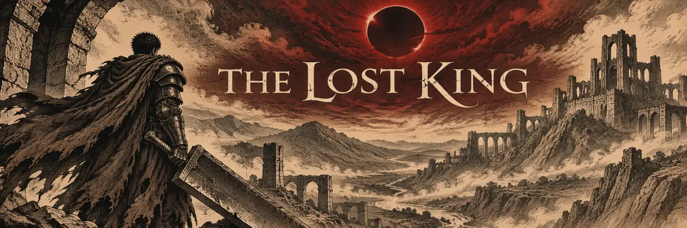

# The Lost King · Expedición de ceniza

**RPG de acción y fantasía oscura para navegador.** Tras el eclipse, un caballero y su compañero arquero buscan al rey desaparecido. Atravesá las ruinas, seguí el rastro de la escolta y enfrentá a los apóstoles. Jugá solo o de a dos en el mismo teclado.

Para jugar en local, descargá [index.html](./index.html) y abrilo en un navegador con conexión a internet.

| Acción | Jugador 1 | Jugador 2 |
|---|---|---|
| Movimiento | WASD | Flechas |
| Ataque | F | K |
| Esquiva | G | L |
| Tajo negro, con armadura | Q | O |

**E** sirve para hablar, avanzar diálogos e interactuar. El audio es opcional.

## La expedición

- Un prólogo a caballo y un mapamundi con caminos que se abren al seguir las pistas.
- Tres apóstoles con poderes distintos y un asedio final en la Fortaleza del Sol Muerto.
- Cooperativo local para dos y música opcional.
